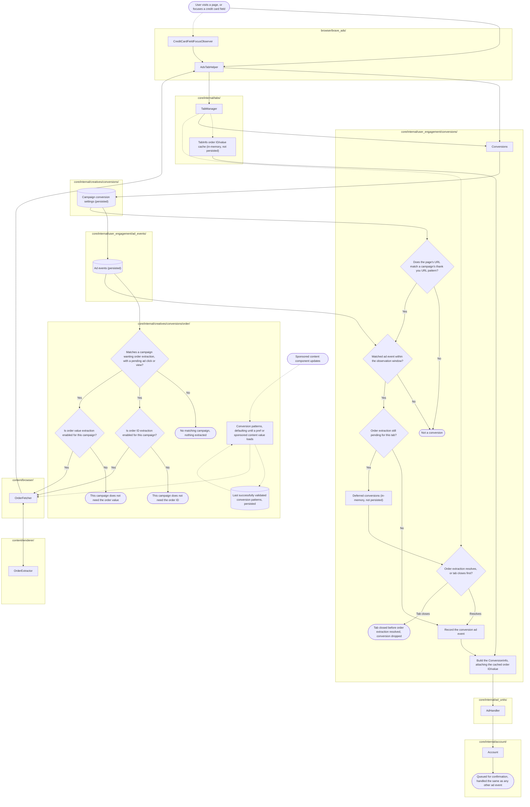

# Conversions

When launching campaigns, advertisers select specific actions. When a user triggers an action, it is counted as a conversion. Conversions include making a purchase or signing up for a newsletter.

| type  | explanation  |
|---|---|
| view-through  | View-through conversions occur when a user is exposed to an ad viewed impression and later completes a desired action, such as making a purchase or filling out a form  |
| click-through  | Click-through conversions occur when a user clicks on an ad and later completes a desired action, such as making a purchase or filling out a form  |

## Architecture

This diagram shows how a page visit becomes an attributed conversion, including reading the order ID and order value from the checkout or thank you page when a campaign's own conversion settings ask for it.

`CampaignConversionInfo`, `AdEventInfo`, the confirmation queue, and the
last successfully validated conversion patterns are persisted and survive
a browser restart. The `TabInfo` order ID/value cache below is in-memory
only and does not survive a browser restart or tab close, but that is not data
loss, since revisiting a matching page before converting re-extracts it,
including when a restored tab reopens the same page on browser launch.

A conversion whose campaign requests order extraction is held back in an
in-memory, unpersisted cache until that tab's order ID/value resolves. If
the tab closes first, the held-back conversion is dropped rather than
reported with incomplete order data it can no longer refresh. Navigating
away instead reports it with whatever order data resolved by then, since
extraction for the page it was waiting on can never resolve afterward.

A solid arrow is a direct dependency or control flow step. A dashed arrow
is a secondary, asynchronous, or optional relationship, such as config
delivery or a cache write that is not itself the main flow. A double-headed
arrow is a synchronous round trip, such as a mojo call and its reply.

