# Conversions

When launching campaigns, advertisers select specific actions. When a user triggers an action, it is counted as a conversion. Conversions include making a purchase or signing up for a newsletter.

| type  | explanation  |
|---|---|
| view-through  | View-through conversions occur when a user is exposed to an ad viewed impression and later completes a desired action, such as making a purchase or filling out a form  |
| click-through  | Click-through conversions occur when a user clicks on an ad and later completes a desired action, such as making a purchase or filling out a form  |

## Architecture

This diagram shows how a page visit becomes an attributed conversion, including reading the order ID and order value from the checkout or thank you page when a campaign's own conversion settings ask for it.

`CampaignConversionInfo`, `AdEventInfo`, and the confirmation queue are
persisted to the ads database and survive a browser restart. The `TabInfo`
order ID/value cache below is in-memory only, scoped to `TabManager`'s
session and gone on restart or tab close, since that difference matters for
anyone relying on either.

A solid arrow is a request/reply or call path. A dotted arrow is schema/config
delivery or an opportunistic, not-guaranteed update. A dashed red arrow would
be a failure or no-op outcome, though every outcome below is instead its own
terminal node, so none currently appear.

```mermaid
%%{init: {"flowchart": {"nodeSpacing": 60, "rankSpacing": 90, "curve": "basis"}}}%%
flowchart TB
  User(["User visits a page, or focuses a credit card field"])
  Component(["Component Updater"])

  subgraph Renderer["content/renderer/"]
    Extractor["OrderExtractor"]
  end

  subgraph ContentBrowser["content/browser/"]
    Fetcher["OrderFetcher"]
  end

  subgraph Browser["browser/brave_ads/"]
    TabHelper["AdsTabHelper"]
    CreditCardObserver["CreditCardFieldFocusObserver"]
  end

  subgraph ConversionsCore["core/internal/user_engagement/conversions/"]
    Conversions["Conversions"]
    UrlPatternMatch{"Does the page's URL match a campaign's thank you URL pattern?"}
    Matched{"Matched ad event within the observation window?"}
    RecordAdEvent["Record the conversion ad event"]
    BuildConversion["Build the ConversionInfo, attaching the cached order ID/value"]
    NoMatch(["Not a conversion"])
  end

  subgraph OrderExtractionGroup["core/internal/creatives/conversions/order/"]
    Schema[("Conversion patterns, falling back to compiled-in defaults until Component Updater delivers a real set")]
    CampaignMatch{"Does this page's URL match a campaign's checkout or thank you URL pattern, with order extraction enabled and a recent ad click or view still waiting to convert?"}
    NoExtract(["No matching campaign, nothing extracted"])
    ExtractIdGate{"Is order ID extraction enabled for this campaign?"}
    NoId(["No order ID requested"])
    ExtractValueGate{"Is order value extraction enabled for this campaign?"}
    NoValue(["No order value requested"])
  end

  subgraph CampaignConversionsGroup["core/internal/creatives/conversions/"]
    CampaignConversions[("Campaign conversion settings (persisted)")]
  end

  subgraph AdEventsGroup["core/internal/user_engagement/ad_events/"]
    AdEvents[("Ad events (persisted)")]
  end

  subgraph Tabs["core/internal/tabs/"]
    TabManagerNode["TabManager"]
    TabInfoCache["TabInfo order ID/value cache (in-memory, not persisted)"]
  end

  subgraph AdUnits["core/internal/ad_units/"]
    AdHandlerNode["AdHandler"]
  end

  subgraph AccountGroup["core/internal/account/"]
    Account["Account"]
    ConfirmationsNode["Confirmations"]
    ConnectedWallet{"Connected Rewards wallet?"}
    BuildReward["Build a Rewards confirmation (v3)"]
    BuildNonReward["Build a non-Rewards confirmation (v4, OHTTP)"]
    ConfirmationTokens[("Confirmation tokens (persisted)")]
    NoTokens(["Dropped, logged as an error, never queued or retried"])
    ConfirmationQueue[("Confirmation queue (persisted)")]
    RedeemQueued["Redeem the queued confirmation"]
    IsRewardConfirmation{"Rewards confirmation?"}
    PaymentTokens[("Unblinded payment tokens, awaiting BAT redemption (persisted)")]
    Sent(["Confirmation sent, no payment tokens"])
    RedeemPaymentTokensNode["RedeemPaymentTokens, runs later on a delay timer"]
    RedeemedForBat(["Batched with every other accumulated payment token and redeemed for BAT"])
  end

  Component -.-> Schema
  User --> TabHelper
  User -.-> CreditCardObserver
  CreditCardObserver --> TabHelper

  %% Order extraction only runs on a page matching a campaign's own
  %% checkout or thank you URL pattern; every other page stops at the gate.
  TabHelper --> Conversions
  Conversions --> CampaignConversions
  CampaignConversions --> AdEvents
  AdEvents --> CampaignMatch
  CampaignMatch -->|No| NoExtract
  CampaignMatch -->|Yes| ExtractIdGate
  CampaignMatch -->|Yes| ExtractValueGate
  ExtractIdGate -->|No| NoId
  ExtractIdGate -->|Yes| Fetcher
  ExtractValueGate -->|No| NoValue
  ExtractValueGate -->|Yes| Fetcher
  Schema -.-> Fetcher
  Fetcher <--> Extractor
  Fetcher --> TabHelper
  TabHelper --> TabManagerNode
  TabManagerNode -.-> TabInfoCache

  %% Conversion recording, on the tab's own navigation notification,
  %% independent of the extraction gate above.
  TabManagerNode --> Conversions
  AdEvents --> UrlPatternMatch
  UrlPatternMatch -->|No| NoMatch
  UrlPatternMatch -->|Yes| Matched
  Matched -->|No| NoMatch
  Matched -->|Yes| RecordAdEvent
  RecordAdEvent --> BuildConversion
  TabInfoCache -.-> BuildConversion
  BuildConversion --> AdHandlerNode
  AdHandlerNode --> Account
  Account --> ConfirmationsNode
  ConfirmationsNode --> ConnectedWallet
  ConnectedWallet -->|Yes| BuildReward
  ConnectedWallet -->|No| BuildNonReward
  BuildReward --> ConfirmationTokens
  ConfirmationTokens -->|No| NoTokens
  ConfirmationTokens -->|Yes| ConfirmationQueue
  BuildNonReward --> ConfirmationQueue
  ConfirmationQueue --> RedeemQueued
  RedeemQueued --> IsRewardConfirmation
  IsRewardConfirmation -->|Yes| PaymentTokens
  IsRewardConfirmation -->|No| Sent
  PaymentTokens -.-> RedeemPaymentTokensNode
  RedeemPaymentTokensNode --> RedeemedForBat
```

