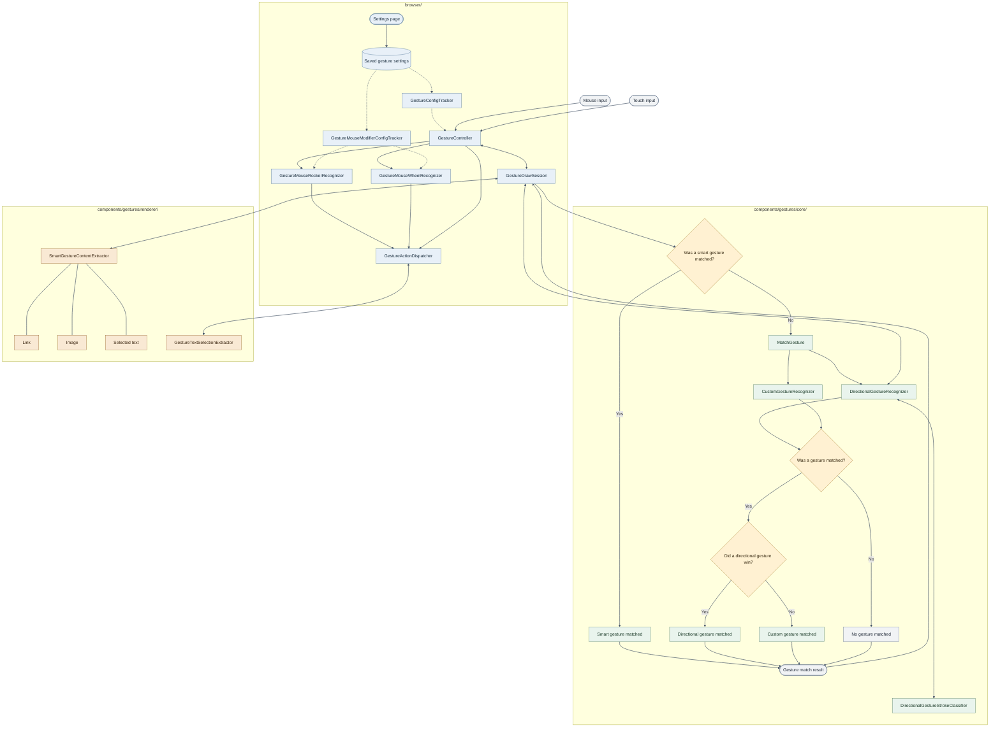

# Gestures

## Overview

Lets the user trigger browser commands by drawing with the mouse (right-click
drag, or Alt/Option+left-click drag) or two-finger touch drag. This document
focuses on drawn gestures; the controller also supports mouse-rocker and
mouse-wheel gestures. Drawn gesture mappings and recognition live under
`components/gestures/core/`, split into `directional/` (8-way stroke gestures,
e.g. `↓→`), `custom/` (freeform traced shapes), and `smart/` (content-aware
cardinal swipes). Browser-process glue (draw tracking, dispatch, and pref
tracking) lives under `browser/ui/gestures/`. The settings UI lives under
`browser/resources/settings/gestures_page/`, with WebUI string registration in
`browser/ui/webui/settings/`.

## Maintainers

- Desktop dev is Terry Mancey.
- Android dev is Aleksei Seren.
- Project lead is w0ts0n.

## Terminology

- A `GesturePath` is the list of `gfx::PointF` sampled while a draw is in
  progress.
- A closed shape is one whose start and end point land close together relative
  to its own length, e.g. a circle. An open shape, e.g. a checkmark, has a
  meaningful start and end.
- Winding direction is which way a closed shape was traced, clockwise or
  counterclockwise.
- Arc length resampling places points at equal intervals along the total
  distance traveled, rather than at a fixed number of original samples.
- A point sequence is a gesture path resampled to a fixed number of ordered
  points, used to compare gesture paths regardless of their original sampling
  density.

## How a draw is matched

A draw is tracked live as a `GesturePath` (a list of `gfx::PointF`) in
`GestureDrawSession`. The directional and custom recognizers, covered below,
each try to match the finished gesture path against what they know. Smart
gestures, covered separately further down, are resolved first and don't go
through this cascade.

### Shape matching algorithm

Both the directional and custom recognizers compare shapes with the same
point-sequence algorithm, split across the `gesture_path_*_util.{h,cc}` files. A
drawn gesture path is resampled to a fixed point count evenly spaced by arc
length (`ResampleGesturePathToPointCount`), then normalized by translating it to
the origin and scaling it so its longer dimension spans 0.0 to 1.0, preserving
its aspect ratio (`NormalizeGesturePathScaleAndTranslation`). This removes the
drawn size and position of the shape from the comparison, so only its
proportions matter.

Two normalized gesture paths are compared by the average distance between points
sharing the same index (`AverageGesturePathDistance`). For a saved custom
gesture path that is closed (its start and end are close relative to its own
length), the matching code tries every rotation of its points in both original
and reversed order, and uses the alignment with the smallest average distance.
The drawn gesture path itself need not be closed for this adjustment.
Directional canonical gesture paths are treated as open and are not rotated or
reversed this way.

A second score, the hit score (`HitScore`), ranges from 0.0 to 1.0 and averages
a per-point score that is 1.0 for a point landing exactly on its counterpart,
falling off linearly to 0.0 at a per-point distance threshold, rather than
counting a hit as all or nothing. For a closed saved custom candidate, the
highest hit score across rotations and both winding directions is computed
separately from the alignment used for average distance. A custom candidate is
eligible only if its average distance is within the maximum and its hit score
meets the minimum. The recognizer picks the eligible candidate with the highest
hit score, breaking ties by lower average distance. This lets a shape that is a
near-exact fit everywhere except a couple of distinctive points beat a shape
that is mediocre everywhere.

### Directional Gestures

As the draw progresses, `DirectionalGestureRecognizer` classifies movement into
one of 8 octant directions (`DirectionalGestureStrokeType`) once it has
sustained far enough (`kDirectionalGestureMinStrokePixels`) and stayed straight
enough (`kDirectionalGestureMinStrokeStraightness`) to commit. A finished draw
is a short sequence of these, like `↓→`, looked up directly in
`DirectionalGestureMapping`.

To let a directional read compete fairly against a custom match (see below), the
resolved stroke sequence is also turned into an idealized polyline
(`DirectionalGestureStrokesToCanonicalPath`) and compared to the actual drawn
gesture path on the same normalized distance scale custom gestures use.

### Custom Gestures

The user can record their own freeform shape (e.g. a checkmark or a circle) and
assign actions to it. Matching ignores drawing speed, size, and placement, using
the same point-sequence algorithm described above to compare the drawn gesture
path against each recorded gesture.

### Picking the winner

`GestureDrawSession::MatchDrawnGesture` calls `MatchGesture` to run the
directional and custom recognizers together. Directional wins if it matches and
is at least as close as the best custom match (within a small epsilon, so
floating-point noise alone can't flip the outcome). Otherwise custom wins if it
matches. A weak directional classification that only explains part of the shape
can still lose to a strong custom match, or to no match at all.

## Smart gestures

Smart gestures are independent of the directional/custom cascade above. A
right-click-drag or Alt/Option+left-click-drag that starts over a link, an
image, or the page's selected text can resolve a single cardinal direction
(up/down/left/right) against a per-content-type action mapping
(`SmartGestureMapping`). It matches only when the gesture path length is within
the smart-gesture limits and an action is mapped for that content type and
direction. A smart match takes priority over shape-based matching; otherwise the
draw falls through to directional/custom matching. See
`components/gestures/core/common/smart/`.

## Architecture

### Matching

`MatchGesture` checks for a smart match first; otherwise, it compares
directional and custom matches, preferring directional on close ties.

### Class responsibilities

| Class                                | Responsibility                                                                     |
| ------------------------------------ | ---------------------------------------------------------------------------------- |
| `GestureController`                  | Routes mouse and touch input to the appropriate gesture handler.                   |
| `GestureDrawSession`                 | Tracks a draw, captures content at its start point, and resolves it when finished. |
| `GestureMouseRockerRecognizer`       | Recognizes a second-button press while the other mouse button is held.             |
| `GestureMouseWheelRecognizer`        | Recognizes wheel movement while the configured modifier is held.                   |
| `GestureActionDispatcher`            | Executes the actions selected for a gesture.                                       |
| `GestureConfigTracker`               | Loads and tracks directional, custom, and smart gesture preferences.               |
| `GestureMouseModifierConfigTracker`  | Loads and tracks mouse-rocker and mouse-wheel preferences.                         |
| `SmartGestureContentExtractor`       | Identifies a link, image, or selected text at the draw's start point.              |
| `GestureTextSelectionExtractor`      | Retrieves selected text when it was not captured at draw start.                    |
| `DirectionalGestureRecognizer`       | Converts pointer locations into directional stroke sequences.                      |
| `DirectionalGestureStrokeClassifier` | Classifies movement into one of eight stroke directions.                           |
| `CustomGestureRecognizer`            | Matches a gesture path against the user's recorded custom gestures.                |
